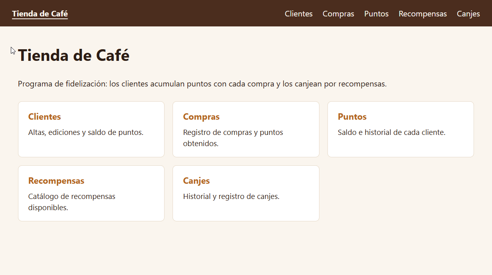
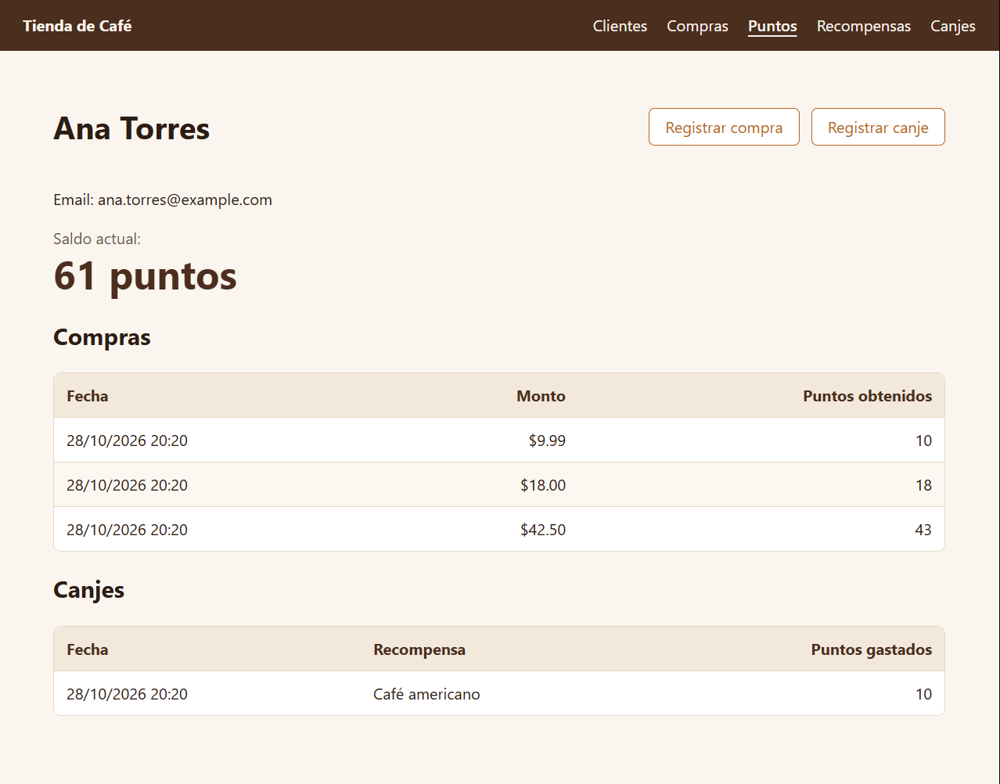
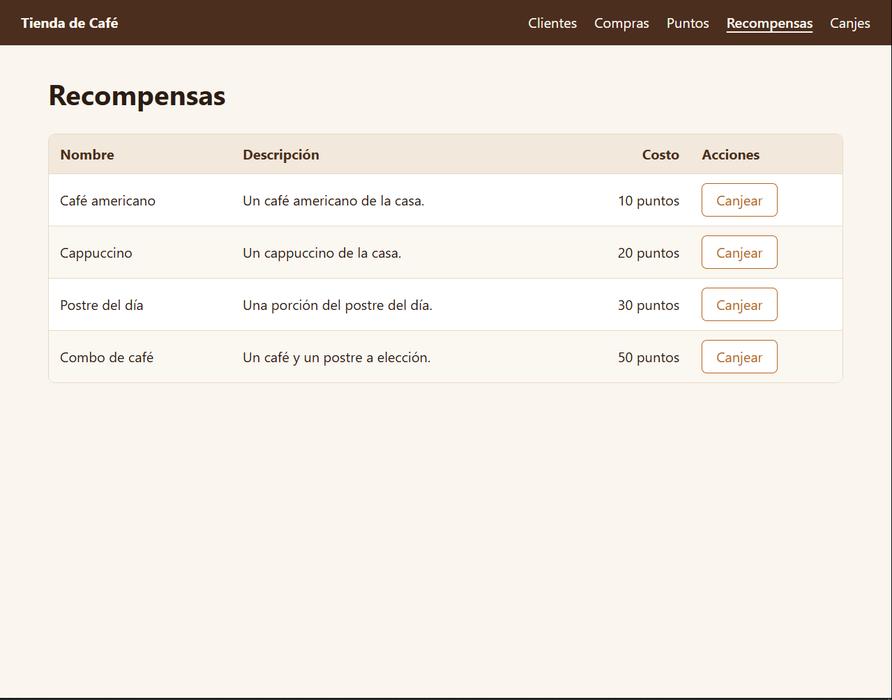
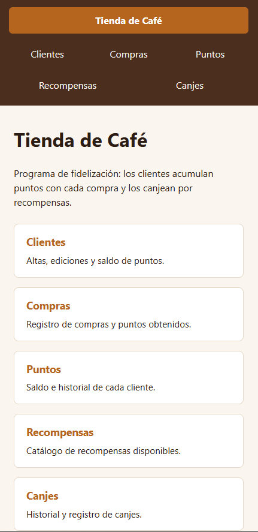

**English** | [Español](README.es.md)

# Coffee Shop · Loyalty App

Web application for a coffee shop where customers earn points with their purchases and redeem them for rewards. It is a portfolio demo built with Java 21, Spring Boot and PostgreSQL, with a server-rendered interface using Thymeleaf.

> **Live demo:** https://coffee-loyalty-tebg.onrender.com. It runs on Render's free plan with the database on Neon: if it has had no visits for a while, the first load can take one or two minutes to wake up. It has no authentication, so it only contains fictional data that anyone can create, edit or delete.

## Screenshots and demo



*Main scenario: a $50.99 purchase earns 51 points (rounded to the nearest dollar), a 30-point redemption leaves the balance at 21, and a second 50-point redemption is rejected for insufficient balance.*

| Points detail | Rewards catalog |
|---|---|
|  |  |

Mobile view of the home screen: the menu rearranges into two rows and the cards use the full width:



## What this project demonstrates

- **Business rules in a service layer**, with a `Controller → Service → Repository` architecture.
- **Balance consistency:** every purchase or redemption updates the balance and saves the movement in a single transaction, with a pessimistic lock on the customer so two simultaneous redemptions cannot leave it negative, checked with a concurrency test.
- **Money with `BigDecimal` and an explicit rounding rule** (`HALF_UP`), tested at its edge cases.
- **Controllable time:** the `Clock` is injected, so tests use fixed dates.
- **Tests at three levels:** unit tests with Mockito, integration tests against a real PostgreSQL database and web flow tests with `MockMvc`; more than 90 in total.
- **Idempotent and atomic demo data**, loaded with a Spring profile.

## Features

- Create, edit and delete customers.
- Register purchases with automatic points calculation.
- View each customer's balance and history of purchases and redemptions.
- Catalog of active rewards.
- Reward redemption with balance validation.
- General history of purchases and redemptions.

## Points rule

**1 point per dollar, rounded to the nearest dollar.** This way, prices ending in `.99` do not penalize the customer.

| Amount | Points |
|---:|---:|
| $0.49 | 0 |
| $9.49 | 9 |
| $9.99 | 10 |
| $25.99 | 26 |
| $50.00 | 50 |

## Tech stack

- Java 21
- Spring Boot, Spring MVC, Spring Data JPA
- PostgreSQL (Neon in the public demo)
- Thymeleaf and HTML/CSS
- Maven
- JUnit 6, AssertJ and Mockito
- Docker, only to deploy on Render

No Lombok: getters, setters and constructors are written by hand.

## Architecture

```text
Controller → Service → Repository → PostgreSQL
```

- **Controller:** receives requests, validates forms and chooses the view.
- **Service:** contains the business rules and the transactions.
- **Repository:** data access with Spring Data JPA.

## Data model

```text
customers 1 ─── N purchases
customers 1 ─── N redemptions
rewards   1 ─── N redemptions
```

Deleting a customer deletes their purchases and redemptions (`ON DELETE CASCADE`). Rewards are never deleted. Table details in [SPECS.md](SPECS.md) §8.

## Business rules

- A customer's email is unique, ignoring uppercase and lowercase.
- A purchase amount goes from $0.01 to $1,000.00 and allows up to 2 decimals.
- A redemption requires an active reward and enough balance; if it is rejected, the balance does not change.
- The balance and the movement are saved in a single transaction, with the customer locked to prevent simultaneous redemptions that leave it negative.
- Purchases and redemptions cannot be changed.

## Routes

| Section | Routes |
|---|---|
| Home | `GET /` |
| Customers | `GET /customers`, `GET /customers/new`, `POST /customers`, `GET /customers/{id}/edit`, `POST /customers/{id}`, `POST /customers/{id}/delete` |
| Purchases | `GET /purchases`, `GET /purchases/new`, `POST /purchases` |
| Points | `GET /points`, `GET /points/{customerId}` |
| Rewards | `GET /rewards` |
| Redemptions | `GET /redemptions`, `GET /redemptions/new`, `POST /redemptions` |

## How to run it

Requirements: Java 21 and PostgreSQL. The project includes the Maven Wrapper, so you do not need to install Maven.

1. Set the database password as an environment variable (it is never saved in the repository):

   ```bash
   export DB_PASSWORD='your-password'
   ```

2. Create the databases:

   ```bash
   PGPASSWORD="$DB_PASSWORD" psql -h localhost -U postgres -c "CREATE DATABASE coffee_loyalty;"
   PGPASSWORD="$DB_PASSWORD" psql -h localhost -U postgres -c "CREATE DATABASE coffee_loyalty_test;"
   ```

3. Start the application with demo data:

   ```bash
   SPRING_PROFILES_ACTIVE=demo ./mvnw spring-boot:run
   ```

4. Open `http://localhost:8080`.

Without the `demo` profile, the application starts with the rewards and no customers.

### Environment variables

| Variable | Required | Default |
|---|---|---|
| `DB_PASSWORD` | Yes | none |
| `DB_URL` | No | `jdbc:postgresql://localhost:5432/coffee_loyalty` |
| `DB_USERNAME` | No | `postgres` |
| `PORT` | No | `8080` |
| `TEST_DB_URL` | No | `jdbc:postgresql://localhost:5432/coffee_loyalty_test` |

Dates are recorded and shown in UTC.

## Tests

```bash
./mvnw test
```

It needs the `coffee_loyalty_test` database to exist. There are more than 90 tests: unit tests of the Services (with `Clock.fixed` and Mockito), integration tests against a local PostgreSQL database (persistence, cascade, transaction rollback, concurrency and demo data, with no H2 or Testcontainers) and web flow tests with `MockMvc` (routes, validations, messages and demo scenarios).

## Demo scenarios

1. **Purchase, accumulation and redemption:** register a customer, buy $50.99 (51 points, because of rounding to the nearest dollar), redeem a 30-point reward (21 left) and try a 50-point one, which is rejected.
2. **Price ending in .99:** a $9.99 purchase earns 10 points.
3. **Fix and delete:** edit an email and delete a customer with movements, with confirmation.

The full script is in [SPECS.md](SPECS.md) §29.

## Technical decisions

- **Points rounding with `HALF_UP` and `BigDecimal`:** money never uses `double`, and `.99` prices do not lose a point.
- **Pessimistic lock on the customer:** purchases and redemptions read the balance with `SELECT ... FOR UPDATE`, so two simultaneous redemptions run one after the other.
- **Transactions:** the movement and the balance are saved together or not at all.
- **Cascade with `@OnDelete`:** the cascade delete is done by the database, and it is checked in the generated schema.
- **Injected `Clock`:** date and time come from a bean, which allows testing with fixed dates.
- **Initial data with `CommandLineRunner`:** idempotent and created by the Services, so balances are consistent with the movements.
- **Java on Render requires Docker:** Render runs Java only through a Docker image, so the project includes a single `Dockerfile` used only to deploy.
- **Neon for the demo database:** its free plan does not expire and it wakes up on its own after being suspended, unlike Render's free database, which expires after 30 days.
- **Startup limited by CPU:** on the free plan (0.1 CPU) the JVM starts in about 60 seconds, compared with 5 on a PC. It was reduced with lazy initialization and without validating the schema at startup; waking the service takes about 80 seconds.

## Out of scope

Authentication, roles, public API, microservices, Docker Compose, Kubernetes, CI/CD, CRUD of rewards, editing or voiding purchases and redemptions, payments, emails, reports, promotions, internationalization and mobile app. Full list in [SPECS.md](SPECS.md) §3.

## Deployment

The public demo runs on Render (free plan) with a Docker image built from the repository's `Dockerfile`, and the PostgreSQL database is on Neon. Configuration is done with environment variables from the Render dashboard, with no secrets in the repository. The service goes to sleep after 15 minutes without visits. Since the application has no authentication, it only contains fictional data. Details in [SPECS.md](SPECS.md) §30.

## AI-assisted development

This project was built with a spec-driven workflow using AI coding agents (Claude, and opencode with DeepSeek). The scope and decisions are written down first in the specification and the phased roadmap, and the rules for the agents live in `AGENTS.md`. Each phase is closed after reviewing the code changes, testing the running app by hand and passing the automated tests. See *Project documentation* below.

## Project documentation

The project documents are written in Spanish.

| File | Content |
|---|---|
| [SPECS.md](SPECS.md) | What is built: scope, rules, model, routes and criteria |
| [CODESTYLE.md](CODESTYLE.md) | How the code is written |
| [ROADMAP.md](ROADMAP.md) | In what order it is built |
| [AGENTS.md](AGENTS.md) | Instructions for AI agents and contributors |
